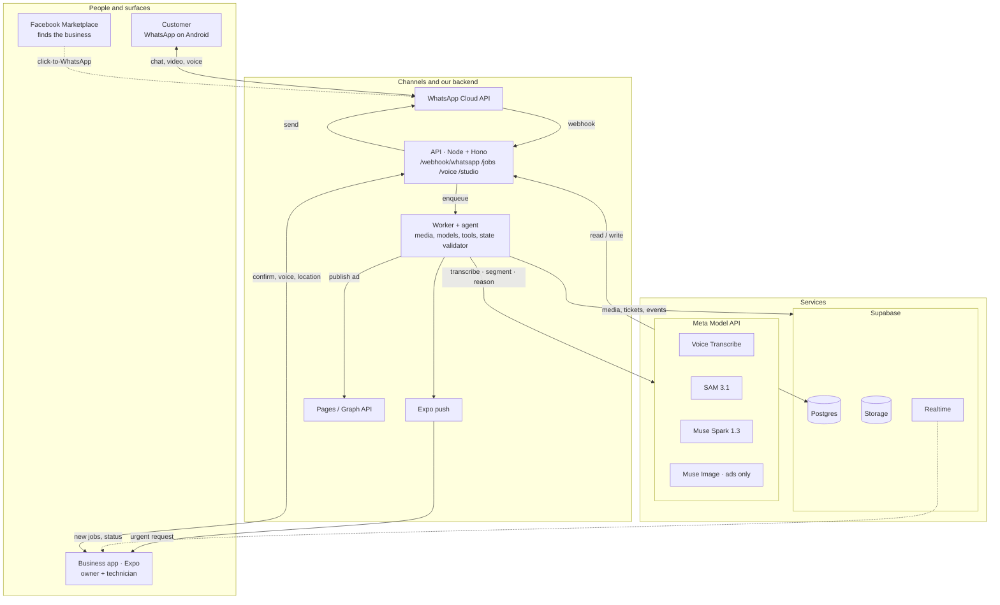
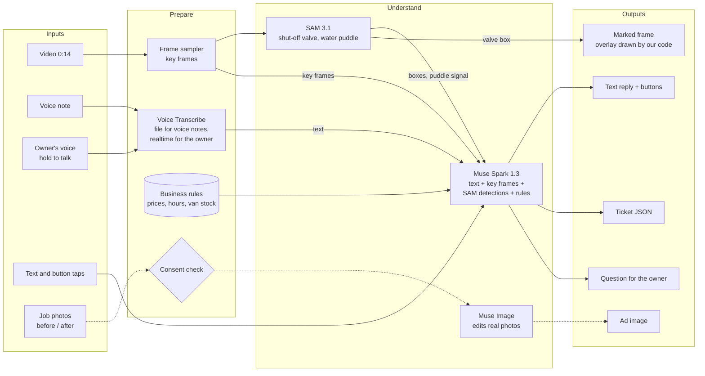
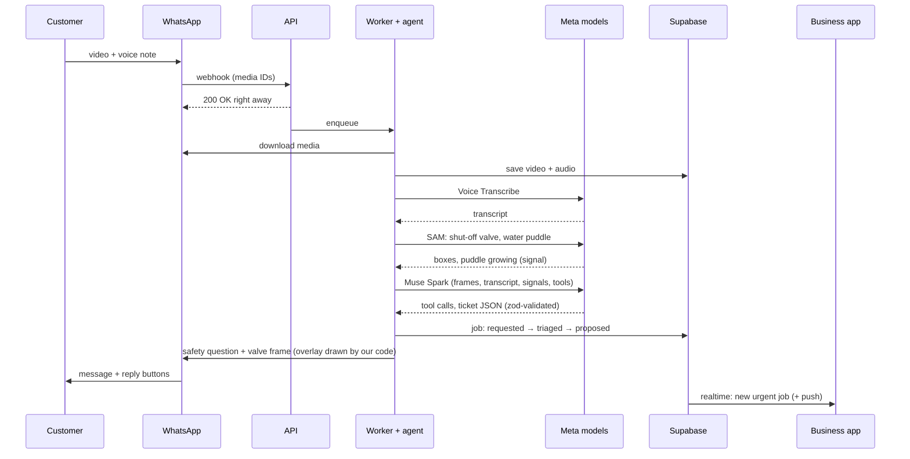
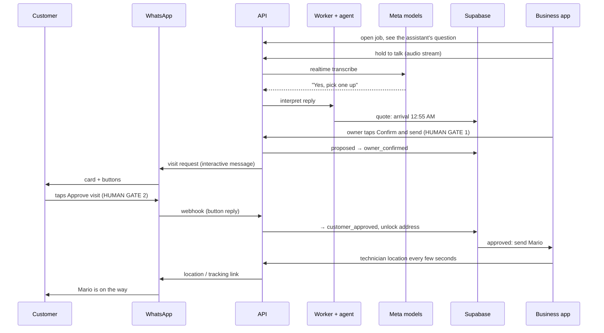
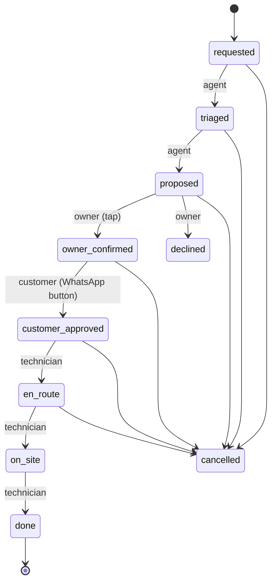
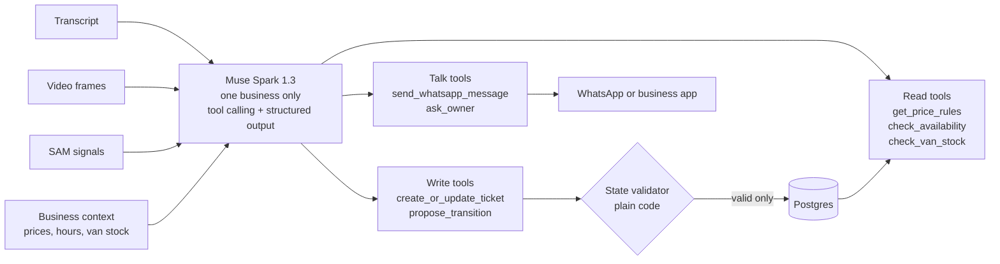

# Architecture: Two Agents, One Confirmed Job

Companion to `02-HANDOFF.md`. These are the same five diagrams as the shared architecture page, written in Mermaid so they can be read as text.

## 1. Components

## 1b. Multimodal pipeline

No text-to-speech: replies are text. Muse Spark never receives raw audio. Safety images are real frames with a code-drawn overlay; Muse Image is used only for ads, after consent.

## 2. From a video to a quote

## 3. The owner confirms, the customer approves

## 4. Job states

Rules: the model can only *propose* a transition. Code validates both the transition and the actor, and writes every move to `job_events`.

## 5. Inside the agent

