# Data model (Supabase)

The schema behind handoff section 6. Source of truth: `supabase/migrations/`.
Run `npm run test:db` (needs Docker) to apply it to a throwaway Postgres +
PostGIS and run the isolation and function tests in `supabase/tests/`.

## ER diagram

```mermaid
erDiagram
  tenants ||--o{ tenant_users : "team"
  tenants ||--o{ price_rules : "prices"
  tenants ||--o{ business_hours : "hours"
  tenants ||--o{ service_areas : "covers"
  tenants ||--o{ handoffs : "is offered"
  tenants ||--o{ jobs : "does"
  tenants ||--o{ linked_accounts : "links"
  tenants ||--o{ content_drafts : "drafts"
  tenants ||--o{ technicians : "staff"
  jobs ||--o{ quotes : "quoted"
  technicians |o--o{ quotes : "assigned"
  conversations ||--o{ conversation_reads : "read markers"
  customers ||--o{ conversations : "starts"
  conversations ||--o{ handoffs : "offered to"
  conversations |o--o| handoffs : "active_handoff_id"
  conversations ||--o{ messages : "contains"
  conversations ||--o{ message_drafts : "polish drafts"
  message_drafts |o--o| messages : "sent as"
  conversations ||--o{ media : "has"
  conversations ||--o{ customer_locations : "exact address"
  conversations ||--o{ consents : "grants"
  conversations ||--o{ jobs : "becomes"
  handoffs ||--o{ handoff_events : "audit"
  handoffs ||--o{ jobs : "leads to"
  jobs ||--o{ job_events : "audit"
  media |o--o{ messages : "attached to"
  auth_users ||--o{ tenant_users : "member"
  auth_users ||--o{ push_tokens : "devices"

  tenants {
    uuid id PK
    text slug UK
    text name
    text category
    text timezone
    geography location
    numeric rating
    bool accepts_now
    bool night_jobs
  }
  tenant_users {
    uuid tenant_id PK, FK
    uuid user_id PK, FK
    tenant_role role
    text display_name
  }
  price_rules {
    uuid id PK
    uuid tenant_id FK
    text item
    price_kind kind
    int min_amount
    int max_amount
    text conditions
  }
  business_hours {
    uuid id PK
    uuid tenant_id FK
    smallint weekday
    time opens
    time closes
  }
  service_areas {
    uuid id PK
    uuid tenant_id FK
    geography center
    numeric radius_km
  }
  customers {
    uuid id PK
    text wa_id UK "hidden from owners"
    text display_name
    text approx_area
  }
  conversations {
    uuid id PK
    uuid customer_id FK
    conversation_state state
    urgency urgency
    uuid active_handoff_id FK
    timestamptz last_message_at
  }
  customer_locations {
    uuid id PK
    uuid conversation_id FK
    geography location
    text address
  }
  handoffs {
    uuid id PK
    uuid conversation_id FK
    uuid tenant_id FK
    handoff_status status
    smallint attempt
    timestamptz expires_at
  }
  handoff_events {
    bigint id PK
    uuid handoff_id FK
    job_actor actor
    handoff_status to_status
  }
  messages {
    uuid id PK
    uuid conversation_id FK
    uuid tenant_id FK "null while with Zukki"
    message_sender sender
    text body
    message_kind kind
    jsonb payload
    bool polished
    uuid media_id FK
    text wa_message_id UK
    delivery_status delivery
  }
  media {
    uuid id PK
    uuid conversation_id FK
    media_kind kind
    text storage_path UK
    text transcript
    jsonb sam_detections
  }
  jobs {
    uuid id PK
    uuid tenant_id FK
    uuid conversation_id FK
    uuid handoff_id FK
    job_state state
    jsonb ticket
    int total_min
    int total_max
  }
  job_events {
    bigint id PK
    uuid job_id FK
    job_actor actor
    job_state to_state
  }
  linked_accounts {
    uuid id PK
    uuid tenant_id FK
    social_platform platform
    uuid token_secret_id "Vault id, hidden"
  }
  content_drafts {
    uuid id PK
    uuid tenant_id FK
    uuid_array source_media_ids
    draft_status status
    uuid reviewed_by
  }
  consents {
    bigint id PK
    uuid conversation_id FK
    consent_kind kind
    bool granted
  }
  push_tokens {
    uuid user_id PK, FK
    text expo_token PK
  }
  message_drafts {
    uuid id PK
    uuid conversation_id FK
    uuid tenant_id FK
    text original_body
    text polished_body
    message_draft_status status
    uuid sent_message_id FK
  }
  technicians {
    uuid id PK
    uuid tenant_id FK
    text display_name
    uuid user_id FK "optional app account"
  }
  quotes {
    uuid id PK
    uuid job_id FK
    jsonb lines
    int total_min
    int total_max
    timestamptz arrival_from
    timestamptz arrival_to
    quote_status status "sent, approved, superseded"
  }
  conversation_reads {
    uuid user_id PK, FK
    uuid conversation_id PK, FK
    timestamptz last_read_at
  }
  platform_settings {
    bool id PK "single row"
    interval urgent_accept_window
    interval normal_accept_window
  }
```

## Who can do what

The Platform API and the WhatsApp orchestrator use `service_role` (bypasses
RLS, so they must scope by tenant in code). The owner app uses the signed-in
user's JWT, so row-level security is the tenant boundary. `anon` gets nothing.

| Data | Owner app (authenticated) |
|---|---|
| tenants, price_rules, business_hours, service_areas | Read all (public directory). Owners edit their own; never `rating`, `review_count`, `slug`. |
| conversations, media, consents | Read while their business holds an offered, accepted or closed handoff. |
| messages | Read Zukki-phase messages (`tenant_id` null) plus their own business's chat. Insert only as `owner`, only in an accepted handoff, never `polished`. |
| customers | `id, display_name, approx_area` only. Never `wa_id`. |
| customer_locations | Only after the customer approved this business's visit. |
| handoffs, jobs, events | Read own. State changes only through the functions below. |
| linked_accounts | Read own (no `token_secret_id`), owners can unlink. |
| content_drafts | Read own; owners edit drafts; approval through `review_content_draft`. |
| message_drafts | Read own business's drafts; insert only in an accepted handoff; never write `polished_body`. |
| push_tokens | Own rows only. |
| technicians | Read own business's; owners add and edit. |
| quotes | Read own; sent through `send_quote`, approved by the customer through `approve_quote`. |
| conversation_reads | Own read markers, only for conversations they can see. |
| platform_settings | No access (server only). |

## Functions (call with `supabase.rpc(...)`)

| Function | Caller | What it does |
|---|---|---|
| `search_directory(category, lat, lng, at?, exclude?, limit?, max_km?)` | API, app | Businesses accepting now, open or taking night jobs, whose service area covers the point. Closest first, then rating. |
| `search_directory_for_conversation(conversation_id, category, exclude?)` | API only | Same search from the customer's latest shared location, so coordinates never pass through the API or the model. Skips businesses this chat was already offered or shown ("Show another option"). Returns `short_name` and `eta_minutes` for payloads 07 and 12. `P0002` if no location yet. |
| `create_handoff(conversation_id, tenant_id, suggested_min?, suggested_max?)` | API only | Offers the request and records the distance and suggested quote for the offer card. Window: the business's own override, else `platform_settings` (defaults: 5 minutes if urgency is `now`, 30 otherwise). One open handoff per conversation. |
| `send_quote(job_id, lines, arrival_from, arrival_to, technician_id?, note?)` | Owner | Sends a quote (payload 13). Totals are the sum of the lines; a new quote supersedes the open one; the job moves to `owner_confirmed`. |
| `approve_quote(quote_id)` | API only | The customer's `quote_approve:<id>` button. Approves only the current quote and moves the job to `customer_approved`, which unlocks the address. |
| `accept_handoff(handoff_id)` | Owner | Accepts in time, or expires the offer if the window closed (returns status `expired`). |
| `decline_handoff(handoff_id, reason?, note?)` | Owner | Declines with a reason (`busy`, `too_far`, `not_offered`, `other`); the conversation goes back to matching. |
| `expire_handoffs()` | API / pg_cron | Expires overdue offers (safe to run from several workers) and returns them so the API can offer the next business. |
| `owner_transition_job(job_id, to_state, reason)` | Owner | Owner side of `packages/shared/src/job-states.ts`. Agent and customer moves stay in the API. |
| `record_job_transition(job_id, from, to, actor, reason)` | API only | Agent and customer moves after the TypeScript validator. Compare-and-set: `40001` if the job changed since it was read. |
| `send_message_draft(draft_id, use_polished)` | Owner | Option B: sends the owner's text or Zukki's version as a queued message (polished goes out as `interactive`). |
| `review_content_draft(draft_id, approve)` | Owner | Approves or rejects a draft. |

Errors come back with the Postgres code: `P0002` not found (or not yours),
`22023` the state does not allow it, `23505` a second open handoff, `23514`
draft media without consent or from another business's job.

## For the WhatsApp integration

- **Inbound:** insert each webhook message with `wa_message_id` and `delivery = 'received'`, using `on conflict (wa_message_id) do nothing`, so Meta's retries are stored once.
- **Kinds:** `text`, `media` (with `media_id`), `interactive`, `button_reply` and `list_reply` (payload = the reply id and title), `location_request`, and `location`.
- **Locations:** save the coordinates in `customer_locations` and store the message as `kind = 'location'` with `payload = {"customer_location_id": ...}`. The database rejects coordinates inside a message payload, because offered businesses can read messages before the customer approves a visit.
- **Outbound:** owner replies arrive as `delivery = 'queued'` (index `messages_outbox_idx`). Send them, then update `delivery` and `wa_message_id`; status webhooks move it to `delivered`, `read` or `failed`. A polished reply has `kind = 'interactive'` and `payload.variant = 'polished_reply'`: send it with the "Written with Zukki, approved by <business>" footer and the Sounds good / Ask a question buttons.
- **Media:** upload to the private `media` bucket at `conversations/<conversation_id>/<file>` and insert a `media` row.
- **Categories:** payload 02 list ids map to `tenants.category` with `categoryFromListReply` in `packages/shared` (`cat_plumbing` to `plumbing`; `cat_other` means ask what they need).
- **Zukki's reply:** `processMessage` in `apps/api/src/worker/process-message.ts` returns the disclosure to send first (payload 01, first message only), the reply text, and `markedFrameUrl` for payload 04's image header.
- **Quote approval:** `button_reply quote_approve:<id>` calls `approve_quote(id)`. An old quote's button fails with `22023`, so the customer only approves what they saw last.

## API functions (migration `api_layer`)

| Function | Caller | What it does |
|---|---|---|
| `resolve_inbound_conversation`, `record_inbound_message` | API only | WhatsApp intake, serialized per customer: one message per `wa_message_id`, one conversation per 24-hour window, reused while a business chat is open. |
| `save_customer_location` | API only | Stores coordinates in `customer_locations` and a referencing message, once. |
| `claim_outbox`, `record_outbound_result`, `record_delivery_status` | API only | Owner and Zukki messages to send, claimed with `SKIP LOCKED`; receipts only move forward. |
| `owner_offers`, `owner_conversations`, `owner_conversation_messages`, `owner_jobs` | Owner | One read per screen, SECURITY INVOKER so RLS applies. |
| `mark_conversation_read` | Owner | Read marker for unread counts. |

HTTP endpoints over these: `docs/API.md`.

## Guarantees the database enforces

- Tenant isolation through RLS on every table (a test fails if a table is missing RLS).
- Privileged code lives in the private schema; the REST API exposes only SECURITY INVOKER wrappers (tested).
- Every foreign key has a covering index (tested).
- A job and its events always belong to the business its handoff went to (composite foreign keys).
- At most one offered or accepted handoff per conversation.
- Webhook retries insert a message once (`wa_message_id` is unique; use `on conflict do nothing`).
- Every handoff and job change writes an audit row in the same transaction.
- Marketing drafts only use media with the customer's latest consent, from the business's own jobs.
- Exact customer coordinates never sit in a message; locations are stored separately and referenced by id.
- Nothing is published without a reviewer (`reviewed_by`) on the draft.

## Hosted project

Supabase project `zukki` (ref `kphaigghspywgkemjhhy`, us-east-1, free plan),
created 2026-10-28 with every migration above and `seed.sql` applied. The
Supabase security advisor reports only "leaked password protection" (an Auth
dashboard setting; owners sign in by magic link) and "RLS enabled, no policy" on
`platform_settings`, which is intentional (server only). The performance
advisor reports only "unused index", expected before real traffic. Keys are never
committed. For development, run Supabase locally from `migrations/` and `seed.sql`
(below), so nobody needs the hosted project's keys.

## Setting up a Supabase project

1. `supabase init` (keeps the existing `migrations/` and `seed.sql`), then `supabase link`.
2. The first migration enables `pg_cron` where available, so the database runs the handoff timer every minute.
3. `supabase db push` for a hosted project, or `supabase db reset` locally (also loads the seed).
4. Clients select explicit columns from `customers` and `linked_accounts`; `select *` is denied because some columns are hidden.
5. Regenerate types for the apps: `supabase gen types typescript --linked > packages/shared/src/database.types.ts`.

## Open questions

- Demo city: the seed uses Cancun coordinates as a placeholder.
- Matching weights beyond distance then rating (handoff open question 3).
- Staff accounts: the `staff` role can read and chat but not edit prices or approve posts.
- Businesses have one category each; multi-category businesses need a join table later.
