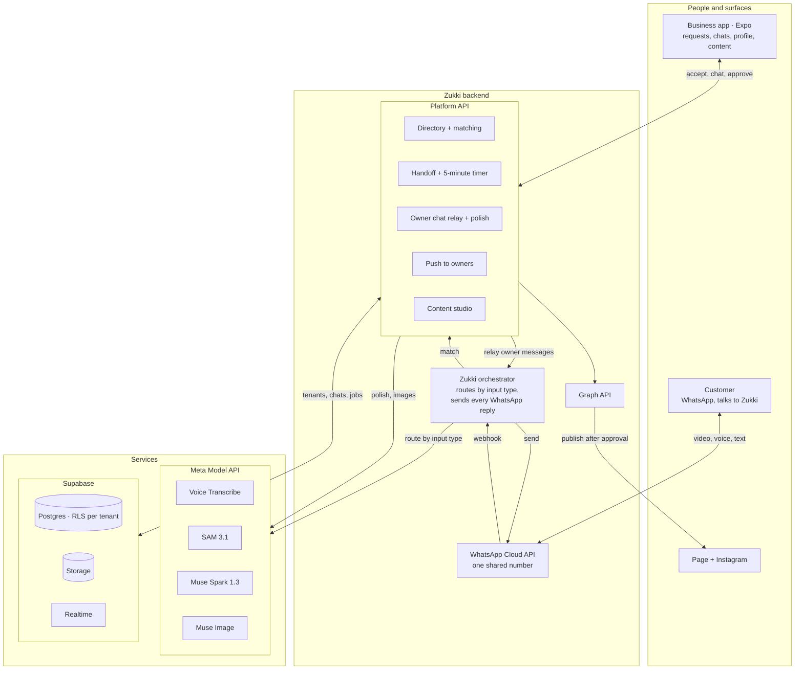
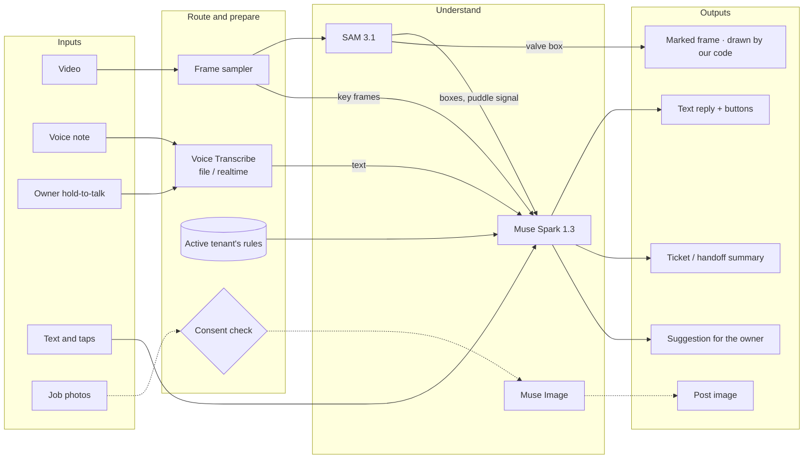
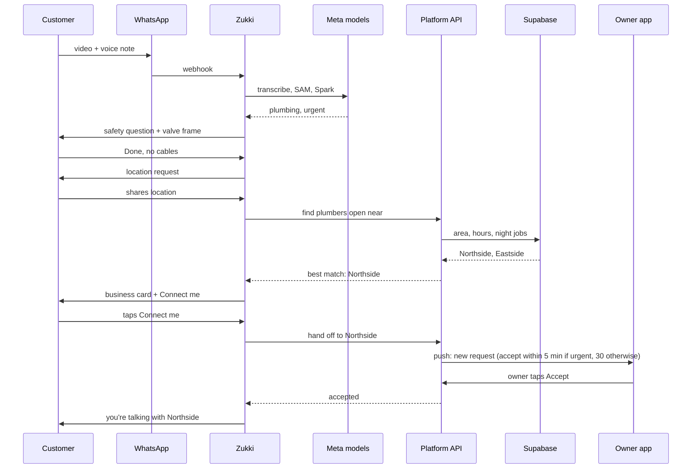
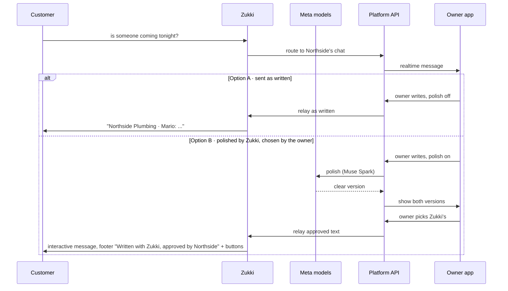
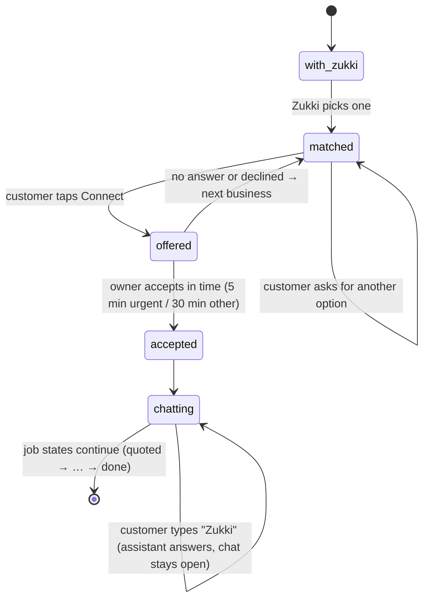
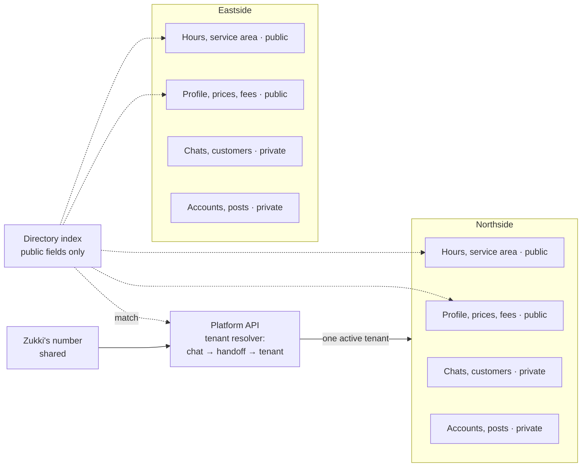
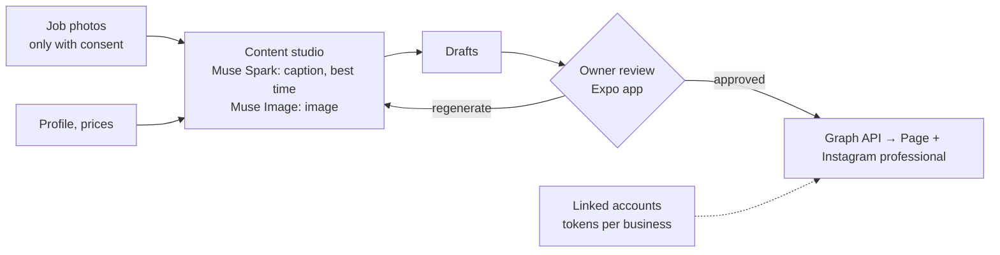
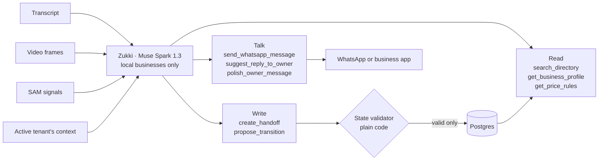

# Architecture: Zukki

Companion to `02-HANDOFF.md`. These are the same eight diagrams as `architecture/architecture.html`, written in Mermaid so they can be read as text.

## 1. Components

## 2. Multimodal routing

## 3. Zukki finds a business

## 4. The owner chats through Zukki

## 5. Handoff states

## 6. Many businesses, one Zukki

Every table carries `tenant_id`, and Postgres row-level security enforces it.

## 7. Content for the business's accounts

## 8. Inside Zukki

